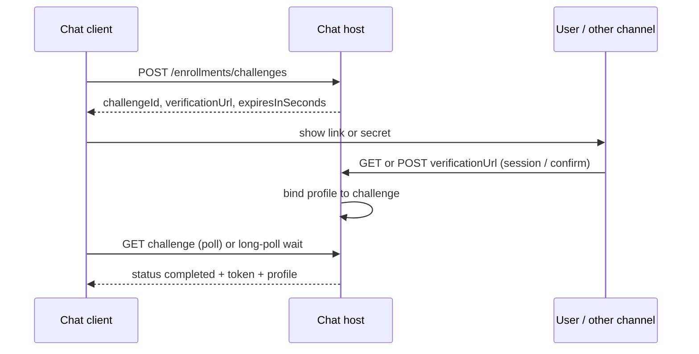

# Simple Chat Protocol

**Status:** v1 (`/chat/v1`)  
**Transport:** HTTP JSON + **SSE** (`text/event-stream`) + **long-poll** fallback — not WebSocket.

This file is the cross-product contract. Reference implementation in this repo: [`go/pkg/chathttp`](go/pkg/chathttp), [`go/pkg/chatcore`](go/pkg/chatcore), [`go/pkg/chatclient`](go/pkg/chatclient). **Product-specific behavior** (extra routes, persistence, integrations) is out of scope here; hosts may implement the same paths with different backends.

---

## Security profiles

| Profile | Client | Server |
|---------|--------|--------|
| **Standalone** | `Authorization: Bearer <token>` (or enroll first) | Chat host validates bearer; optional `token_rotated` on inbox |
| **Embedded** | App **`RequestHook`** on `chatclient` (cookies, gateway JWT, etc.) — no automatic Bearer | App middleware sets **profile** in request context; chat handlers read context only |

JSON paths and bodies are identical; embedded hosts document which headers carry trust.

## Authentication (standalone)

- Header: `Authorization: Bearer <token>` on all chat routes except enrollment endpoints marked **public** below.
- After enrollment, the host maps the token to a **profile** (`profile.code` is the stable participant id used in members APIs and storage).

Hosts may implement one or both **enrollment modes**. Products (e.g. Askoldova login, Slack/WhatsApp linking) typically disable direct exchange and use link verification only.

### Mode A — direct exchange (client-initiated)

The client already holds a one-time or admin-issued **enrollment code** (shared secret out of band). It exchanges that code for a token in a single request.

| Method | Path | Auth | Body | Response |
|--------|------|------|------|----------|
| `POST` | `/chat/v1/enrollments/exchange` | public | `{"code":"<enrollment>"}` | `token`, `expiresInSeconds`, `profile` |

Invalid code → **401** `invalid_enrollment`. Route omitted when the host does not support this mode.

Reference harness: fixed `enrollCode` → fixed dev token (not for production).

### Mode B — link verification (server-driven identity)

The **chat client** does not know who the user is yet. The host creates a short-lived **challenge**, returns an **HTTP verification URL** (and optionally a human-readable **secret** for the other channel). Someone proves identity **via that link** (or the host completes the challenge after an out-of-band check). Only then does the waiting client receive a **token** and `profile`.



#### 1. Start challenge (waiting client)

| Method | Path | Auth | Body | Response |
|--------|------|------|------|----------|
| `POST` | `/chat/v1/enrollments/challenges` | public | optional `{"clientLabel":"<hint>"}` | **201** see below |

**201 body**

| Field | Type | Notes |
|-------|------|--------|
| `challengeId` | string | Opaque id for polling; not secret |
| `verificationUrl` | string | Absolute HTTPS URL for the user (browser or deep link) |
| `secret` | string, optional | Display/copy value; must match unguessable token embedded in `verificationUrl` when present |
| `expiresInSeconds` | int | Challenge TTL |
| `pollUrl` | string, optional | Relative path for status; default `/chat/v1/enrollments/challenges/{challengeId}` |

#### 2. Wait for token (same client)

| Method | Path | Auth | Response |
|--------|------|------|----------|
| `GET` | `/chat/v1/enrollments/challenges/{challengeId}` | public | Status JSON |

**Status `pending`:** `{"status":"pending","expiresInSeconds":<n>}`

**Status `completed`:** `{"status":"completed","token":"<bearer>","expiresInSeconds":<n>,"profile":{…}}` — same shape as mode A.

**Status `expired`:** **410** `enrollment_challenge_expired`

Optional: `GET …/challenges/{challengeId}?wait=<seconds>` long-polls up to `wait` (max host-defined, e.g. 30) and returns `completed` in one response when verification finishes; otherwise `pending`.

The chat client should poll (or long-poll) until `completed` or expiry. **Do not** put the bearer token in the verification URL.

#### 3. Verify identity (other channel — browser or product UI)

The host serves `verificationUrl` (path is product-defined; recommended prefix `/chat/v1/enrollments/verify/{secret}`).

| Method | Path | Auth | Purpose |
|--------|------|------|---------|
| `GET` | `/chat/v1/enrollments/verify/{secret}` | optional session | HTML or JSON “confirm link device” when the user is already signed in elsewhere |
| `POST` | `/chat/v1/enrollments/verify/{secret}` | session or product auth | User confirms; host resolves **profile** from that session |

Success: **200** or **204** (and optional HTML). Side effect: matching challenge → `completed`, token minted for the waiting poll.

Unknown or expired secret → **404** `verification_not_found`. Already used → **409** `verification_already_used`.

**Who is the client?** Resolved only at verify time: logged-in web user, admin assertion, or host logic after WhatsApp/Slack/email proved the same `secret`. The reference repo does not implement mode B; products own session stores and anti-abuse.

#### 4. Service completion (optional)

When verification happens entirely outside HTTP (e.g. operator pastes secret in backoffice), the host may expose:

| Method | Path | Auth | Body |
|--------|------|------|------|
| `POST` | `/chat/v1/enrollments/challenges/{challengeId}/complete` | service / admin | `profile` object (same fields as below) |

→ **200** with `token`, `expiresInSeconds`, `profile`; waiting client’s next poll also sees `completed`.

### Profile (both modes)

| Field | Type |
|-------|------|
| `code` | string |
| `displayName` | string |
| `role` | `user` \| `admin` |
| `createdAt`, `updatedAt` | RFC3339 |

---

## Conversations

A **conversation** is identified by `code` (JSON field `code` on list items; events use `sessionId` for the same id).

| Method | Path | Body / query | Response |
|--------|------|--------------|----------|
| `GET` | `/chat/v1/conversations` | `?archived=true` optional | `{ "conversations": [Session, …] }` |
| `POST` | `/chat/v1/conversations` | optional `{"title":"<label>"}` | `Session` |
| `PATCH` | `/chat/v1/conversations/{code}` | `{"title":"<label>"}` | `Session` |

`title` is the human-readable room label shown in conversation lists. Storage and who may rename are product-defined.

### Members (multi-user rooms)

Membership persistence is **product-defined**. Callers with access to the conversation may manage members:

| Method | Path | Body | Response |
|--------|------|------|----------|
| `GET` | `/chat/v1/conversations/{code}/members` | — | `{ "members": ["<profileId>", …] }` |
| `POST` | `/chat/v1/conversations/{code}/members` | `{"profileId":"<id>"}` | `201` + `{ "profileId" }` |
| `DELETE` | `/chat/v1/conversations/{code}/members/{profileId}` | — | `204` |

- `profileId` is the host’s stable participant/profile identifier (same namespace as enrollment `profile.code`).
- **Cannot remove the last member** → **409** `last_member`.
- Unknown member → **404** `member_not_found`; duplicate add → **409** `member_already_present`.
- If the host does not implement membership → **501** `members_not_supported`.

**Session (list item)**

| Field | Type |
|-------|------|
| `code` | string |
| `title` | string |
| `lastMessageAt` | RFC3339 |
| `reviewSummary` | string, optional |

---

## Sending messages

Posting and delivery are **decoupled**. The HTTP response acknowledges acceptance only; **server replies (if any) are never returned in the POST body** — receive on the **profile inbox** (`/inbox/events` or `/inbox/feed`).

| Method | Path | Body | HTTP | Notes |
|--------|------|------|------|--------|
| `POST` | `/chat/v1/conversations/{code}/messages/plain` | `{"message":"<text>"}` | **201** + client **Event** | **Sync send:** message stored and published on the delivery journal |
| `POST` | `/chat/v1/conversations/{code}/messages/async` | `{"message":"<text>"}` | **202** + `{"messageId","cursor"}` | **Async send:** accepted for host-defined follow-up; further events on SSE/feed; **no follow-up is guaranteed** |

There is **no** question–answer route (`POST .../messages` with `{"reply":...}` in the response). Clients must run **SSE or long poll** before or while sending.

Empty or whitespace-only `message` → **422** `message_required`.

---

## Delivery event (JSON)

Used in inbox SSE/feed, and plain-message responses (without `inboxCursor`).

| Field | Type | Notes |
|-------|------|--------|
| `inboxCursor` | int64 | Monotonic per **profile** (inbox only) |
| `cursor` | int64 | Monotonic per conversation |
| `sessionId` | string | Conversation `code` |
| `requestId` | string | Optional; correlates an async send with later events |
| `messageId` | string | UUID |
| `sender` | string | `client` \| `server` |
| `kind` | string | `message`, `progress`, `error`, `reply` (legacy), `conversation_updated`, `member_added`, `member_removed`, `binding`, `token_rotated` |
| `text` | string | Body or aggregated progress |
| `createdAt` | RFC3339 | UTC |

---

## Profile inbox (receive)

One authenticated stream per profile. Events include `sessionId` (conversation `code`) for demuxing.

### SSE

`GET /chat/v1/inbox/events`

- `Accept: text/event-stream`
- Resume: `Last-Event-ID: <inboxCursor>` or `?cursor=<inboxCursor>`
- Frames: `id: {inboxCursor}\nevent: {kind}\ndata: {JSON InboxEvent}\n\n`
- Idle: `: heartbeat\n\n` about every **15s**
- Expired inbox cursor: `event: error\ndata: {"error":"inbox_cursor_expired"}\n\n`

### Bulk long poll

`GET /chat/v1/inbox/feed?cursor=<inboxCursor>&limit=<n>&wait=<seconds>`

- Response: `{"inboxCursor":<n>,"events":[…]}` (empty `events` on timeout).

### Inbox cursor

`GET /chat/v1/inbox/cursor` → `{"inboxCursor":<n>}`.

**Journal (core):** in-memory ring of last **100** inbox events per profile; per-conversation `cursor` is still assigned on send. Inbox cursor older than retained window → **409** `inbox_cursor_expired`.

### Inbox presence and push suppression

- The host marks a profile **inbox-connected** while `GET /chat/v1/inbox/events` is open; the mark clears when the stream ends.
- After a **message** is published, the host may send a **mobile push** to other members’ registered devices. If a recipient profile is inbox-connected on **this host**, skip push for that profile (inbox delivery is unchanged).
- Multi-node deployments need shared presence or client-side deduplication; the reference servers track presence in-process only.

---

## Mobile devices and push

### Device registration (authenticated)

| Method | Path | Body | Response |
|--------|------|------|----------|
| `PUT` | `/chat/v1/devices/{deviceId}` | see below | **200** device record |
| `DELETE` | `/chat/v1/devices/{deviceId}` | — | **204** |
| `POST` | `/chat/v1/devices/{deviceId}/heartbeat` | optional `{"foreground":true}` | **204** |

**`PUT` body**

| Field | Type | Notes |
|-------|------|--------|
| `platform` | `ios` \| `macos` \| `android` | Required |
| `pushChannel` | `apns` \| `fcm` | Required; `ios`/`macos` → `apns`, `android` → `fcm` |
| `pushToken` | string | Opaque token from OS (APNs device token or FCM registration token) |
| `appBundleId` | string, optional | APNs topic / bundle id; required for APNs in production |
| `locale` | string, optional | For localized push copy later |

**Device record (response)**

| Field | Type |
|-------|------|
| `deviceId` | string (client-chosen stable id per install) |
| `profileId` | string (from auth) |
| `platform`, `pushChannel` | enums |
| `lastSeenAt` | RFC3339 |
| `foreground` | boolean, optional hint from last heartbeat |

Errors: `device_id_required`, `push_token_required`, `invalid_platform`, `invalid_push_channel`, `device_not_found`.

`pushToken` is secret-like; never log the full value; HTTPS only.

### Push payload (host → APNs/FCM data)

Not returned on HTTP API; documented for mobile handlers:

| Field | Purpose |
|-------|---------|
| `type` | `chat_message` |
| `sessionId` | Conversation `code` |
| `messageId` | UUID |
| `inboxCursor` | optional hint for sync |
| `sender` | `client` \| `server` |
| `preview` | truncated message text (host-defined max length, e.g. 120 chars) |

Display title/body: host or client maps `preview` + conversation title; the protocol does not mandate notification UI strings.

**Client lifecycle:** after login/enrollment, `PUT` with OS push token; refresh on token change; periodic `POST …/heartbeat` (e.g. every 15–30 min, more often in foreground); `DELETE` on logout. Notification tap: deep-link with `sessionId` and optional `inboxCursor`; sync via inbox.

---

## Errors

HTTP JSON envelope:

```json
{"error":{"code":"<machine_code>","message":"<text>"}}
```

Common codes: `unauthorized`, `conversation_not_found`, `message_required`, `title_required`, `invalid_cursor`, `cursor_expired`, `invalid_inbox_cursor`, `inbox_cursor_expired`, `member_not_found`, `member_already_present`, `last_member`, `invalid_enrollment`, `enrollment_challenge_expired`, `verification_not_found`, `verification_already_used`, `device_id_required`, `push_token_required`, `invalid_platform`, `invalid_push_channel`, `device_not_found`.

---

## Optional extensions

| Method | Path | Purpose |
|--------|------|---------|
| `POST` | `/chat/v1/conversations/{code}/archive` | Archive + review (204) |
| `POST` | `/admin/chat/bootstrap` | First admin + enrollment (`ADMIN_TOKEN`) |

Minimal implementations (Java/Go stubs in this repo) implement **plain + async accept + inbox feed/events**. Optional routes below and host logic behind `/messages/async` are product choices.

---

## Implementations in this repo

| Component | Location |
|-----------|----------|
| Go library | `go/pkg/chatcore`, `go/pkg/chatclient`, `go/pkg/chathttp` (`go/pkg/session` = in-memory demo store only) |
| Go server / client | `go/server`, `go/client` |
| Java server / client | `java/server`, `java/client` (stubs; duplicate protocol as needed) |

Other products copy from `go/pkg/` per [SYNC.md](SYNC.md); they do not import this module as a runtime dependency unless explicitly chosen later.

Breaking wire changes require a new API prefix or documented migration; do not rename JSON fields without updating all clients.
